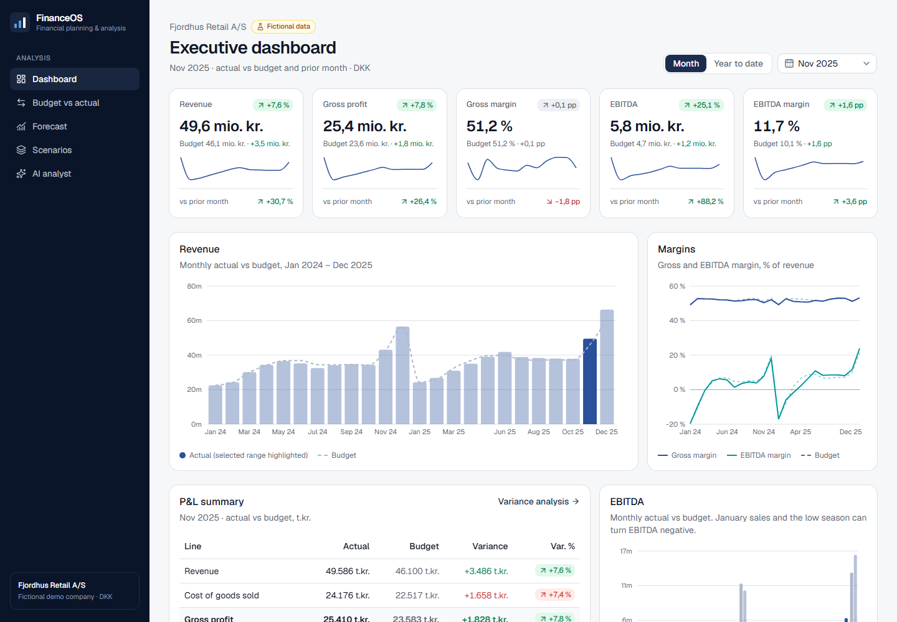
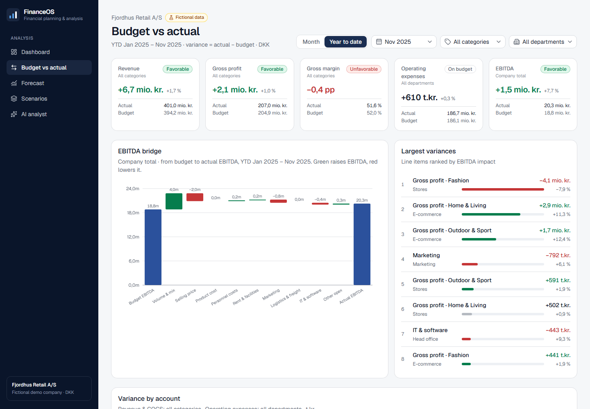
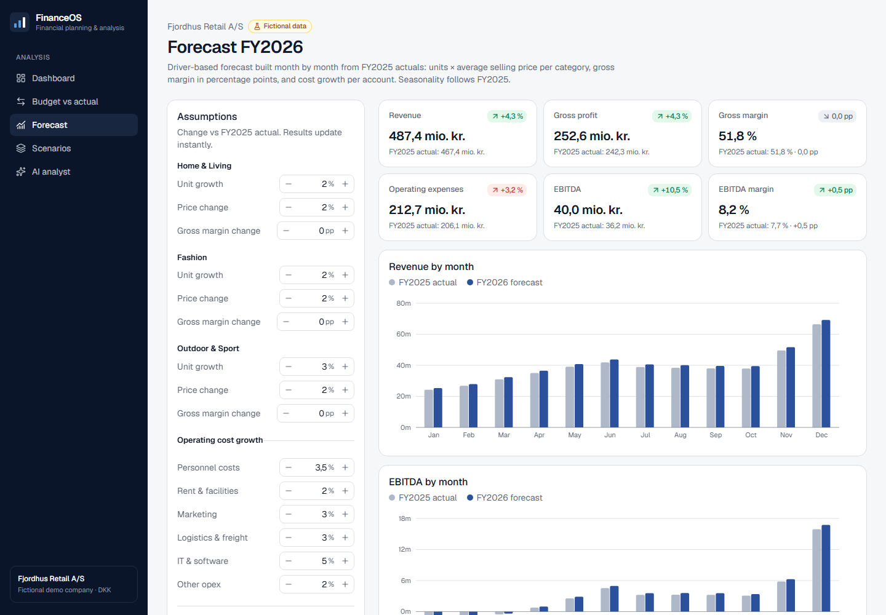
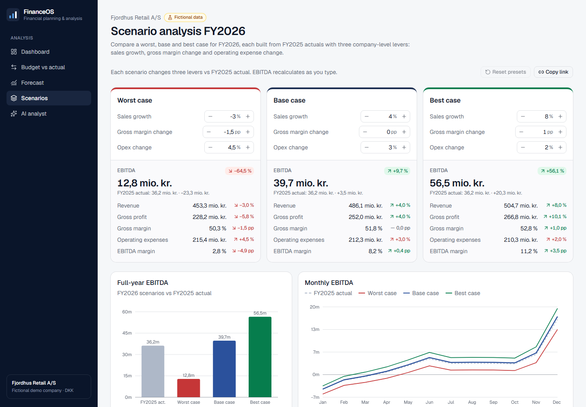
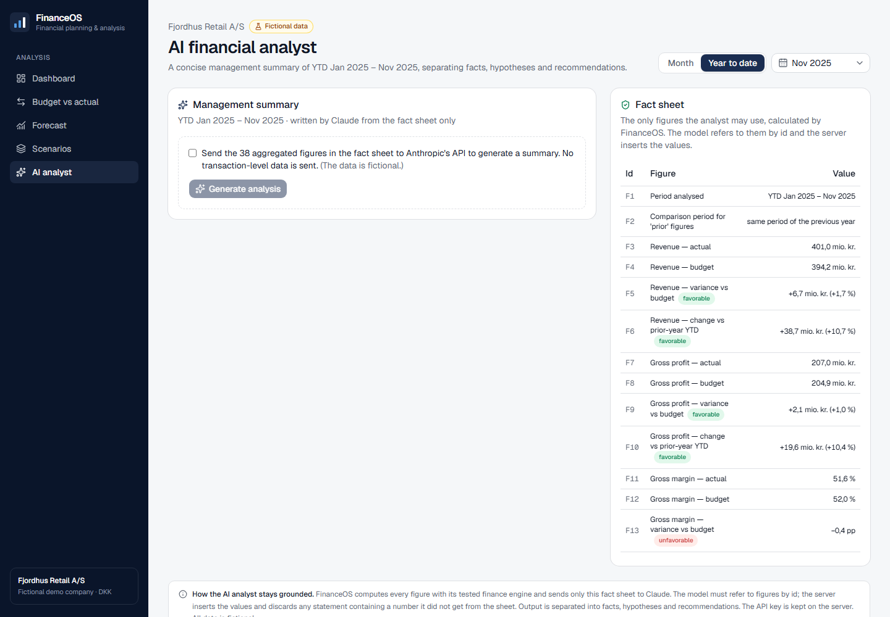

# FinanceOS

**A financial planning & analysis (FP&A) platform for finance managers**, built on a
fictional Danish retailer, **Fjordhus Retail A/S**. It has an executive dashboard, budget vs
actual analysis with price/volume/mix, a driver-based forecast, scenario analysis and an AI
analyst that cannot invent numbers.

**Live demo:** https://financeos-kappa-nine.vercel.app · **Demo script:** [`docs/DEMO.md`](docs/DEMO.md)

> ⚠️ **All company data is fictional.** It is generated for demonstration and does not
> represent any real company.



## What it does

| Module | Question it answers | Highlights |
|---|---|---|
| **Executive dashboard** | How are we doing this month and year to date? | KPI cards vs budget and prior period, revenue/margin/EBITDA trends, P&L summary, category table |
| **Budget vs actual** | What drives the deviation from budget? | EBITDA bridge, largest variances ranked by EBITDA impact, three-way price/volume/mix, cost by department, materiality thresholds |
| **Forecast** | Where will FY2026 land? | Driver-based: units × price per category, margin in pp, cost growth per account, "show formulas" view, shareable links |
| **Scenarios** | What if things go better or worse? | Worst/base/best with live EBITDA, closed-form formula, sensitivities, ordering warning |
| **AI analyst** | What should management take away? | Claude writes from a validated fact sheet only; facts, hypotheses and recommendations kept apart |

<table>
  <tr>
    <td></td>
    <td></td>
  </tr>
  <tr>
    <td></td>
    <td></td>
  </tr>
</table>

## Design principles

1. **One source of truth for every number.** All calculations live in pure, tested functions
   in `src/lib/finance/`. Pages and charts only display results.
2. **Favorable/unfavorable follows the account, not the sign.** Costs above budget are red.
   Variances under 1 % or 50 t.kr. count as on budget.
3. **Missing is not zero.** A missing or undefined value shows as "n/a", never as a misleading 0.
4. **Transparent models.** Every forecast and scenario figure can be traced back to a
   formula, and the page shows that formula with the actual numbers.
5. **AI that cannot invent figures.** The model refers to facts by id (`{{F12}}`). The server
   rejects any statement with a number it didn't supply, then inserts the validated values.

## Key definitions

- Revenue = units × average selling price
- Gross profit = revenue − COGS; gross margin = gross profit ÷ revenue
- EBITDA = gross profit − operating expenses (excludes depreciation & amortisation)
- Variance = actual − budget; variance % = variance ÷ |budget|
- Margin changes are in percentage points (pp)

Full formulas, data schema and design decisions: [`docs/ARCHITECTURE.md`](docs/ARCHITECTURE.md).

## Quality

- **205 automated tests** (Vitest) across 13 files. They cover the finance engine, data
  integrity of the seed, every view-model, and two financial QA suites with independent
  reconciliations: [`docs/qa/m3-forecast-qa.md`](docs/qa/m3-forecast-qa.md) and
  [`docs/qa/m4-scenarios-qa.md`](docs/qa/m4-scenarios-qa.md).
- TypeScript strict mode, ESLint, and a production build check before every commit.
- Accessibility: keyboard focus styles, a skip link, text alternatives for charts, and status
  shown in text as well as colour.

## Tech stack

Next.js 16 (App Router) · React 19 · TypeScript (strict) · Tailwind CSS · shadcn/ui ·
Recharts · Zod · Vitest · Anthropic API (`claude-opus-5-5`) · Vercel

## Getting started

Prerequisites: [Node.js](https://nodejs.org/) 22 LTS or newer, and Git.

```bash
git clone https://github.com/fred2601/financeos.git
```

```bash
cd financeos
```

```bash
npm install
```

```bash
npm run dev
```

Open http://localhost:3000.

| Command | Purpose |
|---|---|
| `npm run dev` | Development server |
| `npm test` | Unit tests |
| `npm run check` | Typecheck + lint + tests |
| `npm run build` | Production build |
| `npm run seed` | Regenerate the fictional dataset (deterministic) |

### Environment variables

Only the AI analyst needs one. Copy `.env.example` to `.env.local`, and add the same variable
in Vercel → Project → Settings → Environment Variables for the live site:

```
ANTHROPIC_API_KEY=   # server-side only, never exposed to the browser
```

Without a key, the AI analyst page still shows its fact sheet and explains that the feature
isn't configured. Set a monthly spend limit on the key in the Anthropic Console, because the
live demo is public.

## Project structure

```
src/
├─ lib/finance/      calculations: metrics, variance, materiality, price/volume/mix, forecast, scenarios
├─ lib/selectors/    view-models per page (call lib/finance, return plain data)
├─ lib/analyst/      AI fact sheet, prompt, output validation, guards
├─ lib/data/         schema (Zod), chart of accounts, dataset loader
├─ lib/format/       Danish number formatting
├─ components/       layout, charts, page components, shadcn/ui
├─ app/              pages + /api/analyst route
└─ data/seed/        generated fictional dataset
scripts/generate-seed.ts
docs/                architecture, data storyline, roadmap, QA reports, demo script
```

## Assumptions & limitations

- One company, DKK only, fiscal year = calendar year. There is no balance sheet, cash flow,
  VAT or inventory.
- Rent is treated as an operating expense (pre-IFRS 16 management view).
- The forecast copies FY2025 seasonality and one-off effects. Drivers apply evenly to all months.
- Scenario levers are company-wide, and costs don't flex automatically with sales.
- There are no user accounts or database. Assumptions live in the URL.
- AI hypotheses and recommendations are suggestions to review. Only the figures are guaranteed.
- CSV/Excel import (roadmap M5) is not built yet.

See [`docs/ROADMAP.md`](docs/ROADMAP.md) for the milestone history.

## Author

Built as a portfolio project by a Finance (BSc) student in Denmark, with Claude Code as a
pair programmer.
